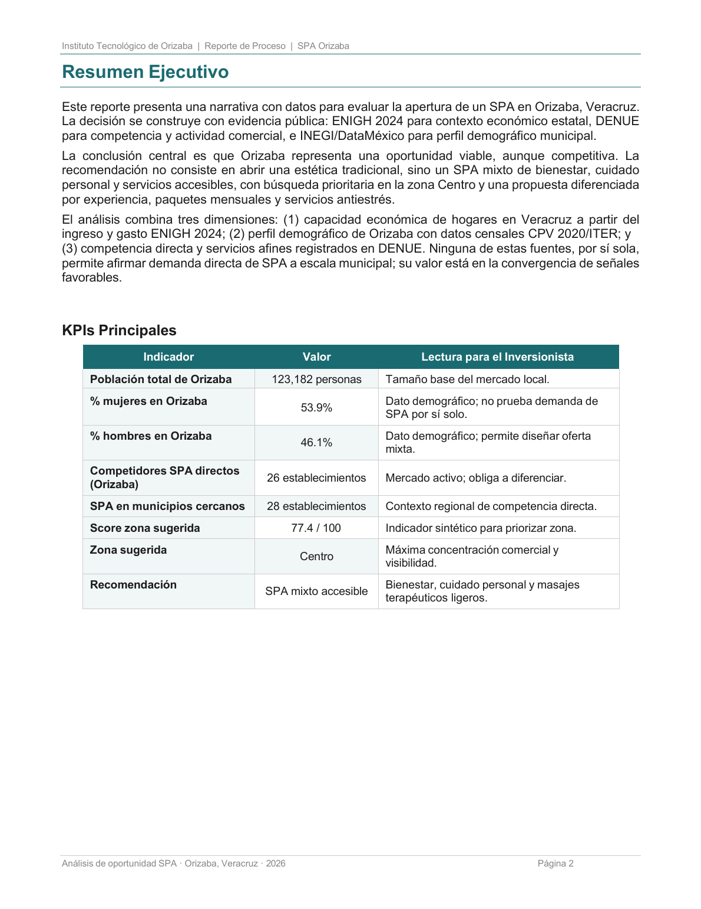

# SPA Orizaba Market Analysis

**An exploratory market study combining public economic, demographic, and business-directory data for Orizaba, Veracruz.**

The academic project evaluated signals relevant to a potential wellness SPA. It combines public datasets to frame the local market and communicate an initial opportunity assessment. It is descriptive and exploratory: it does not estimate direct SPA demand, predict revenue, or guarantee commercial viability.

## Objective

Bring together heterogeneous public sources to compare regional economic context, municipal demographics, and identified SPA-related establishments.

## My contribution

**Technical data work**

- Located and reviewed relevant public data sources.
- Cleaned, transformed, and integrated data from ENIGH, DENUE, and census/ITER sources.
- Prepared indicators and analysis outputs for the project report.
- Supported the team with the technical basis for communicating findings.

Storytelling and presentation communication were handled by other team members. This repository describes my technical contribution without publishing their personal details.

## Data and methods

- **ENIGH 2024:** state and national income/spending context; it is not municipal SPA demand.
- **DENUE:** registered establishments used to count identified SPA-related competitors.
- **Census 2020 / ITER:** demographic context for Orizaba and nearby municipalities.
- **Python, pandas, NumPy, Matplotlib:** data cleaning, transformation, weighted calculations, exploratory indicators, and charts.

## Reported figures

The team report dated May 2026 reports **123,182 residents in Orizaba**, **26 direct SPA establishments in Orizaba**, and **28 SPA establishments in nearby municipalities**. These are report figures, not a direct measurement of demand or profitability. The included page is shown as a source artifact; this documentation showcase does not independently reproduce the calculations.

## Limitations

- ENIGH is used for state/national context and cannot establish municipal SPA demand.
- A DENUE listing indicates a registered establishment, not its demand, revenue, or profitability.
- The report’s suggested-zone score is not independently reproduced in the accessible analysis repository and is not presented here as a validated investment score.
- This showcase includes no raw data or interactive geospatial map. Location analysis is described only at the municipal level supported by the available materials.
- No machine-learning model or predictive analysis is claimed.

## Related project links

- [Analysis repository (already public)](https://github.com/Tecomahua/spa-orizaba-analisis)
- [Developer portfolio repository](https://github.com/Tecomahua/javier-martinez-portfolio)

## Source and privacy

This showcase repository is documentation-only. The related analysis repository remains separate and unchanged. No raw dataset, source report PDF, personal contact data, code history, credentials, or private configuration is copied here.
